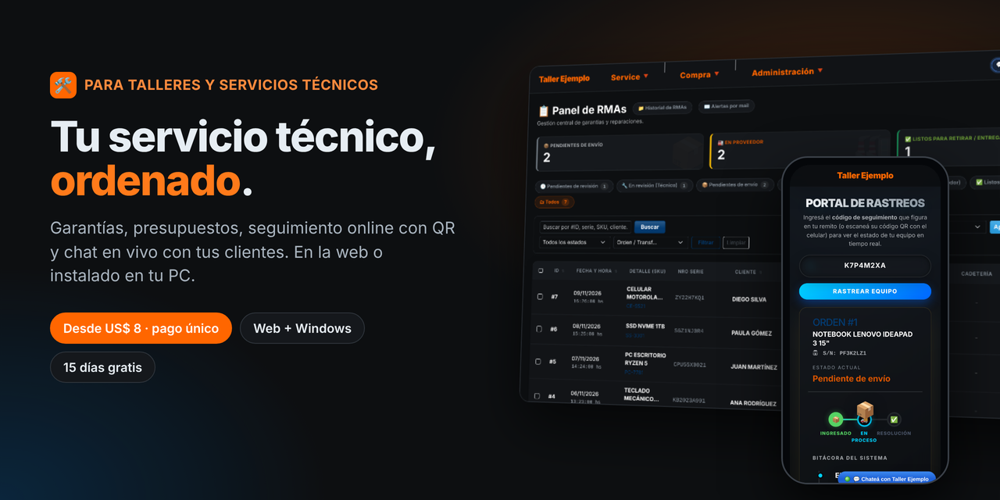
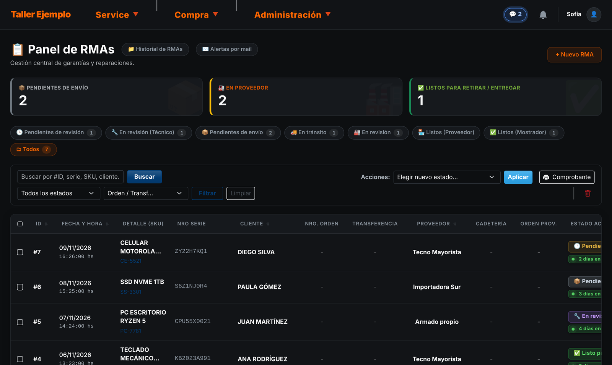
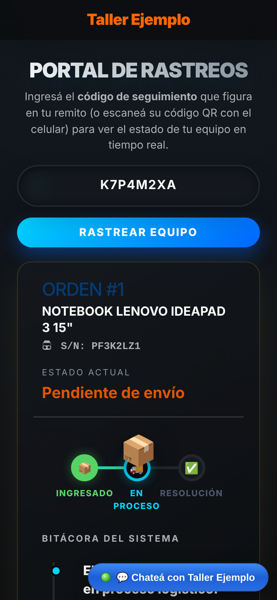
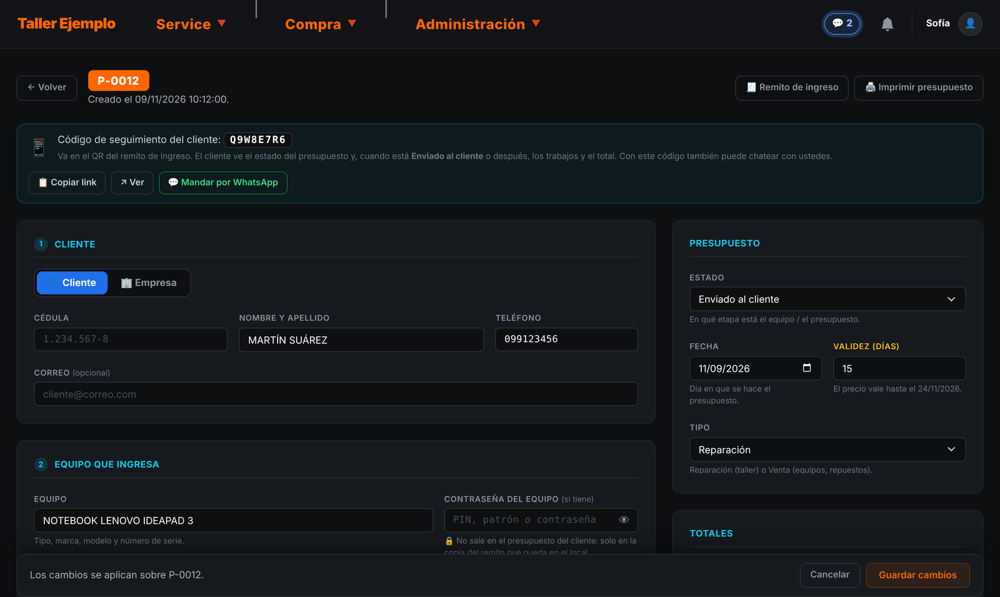
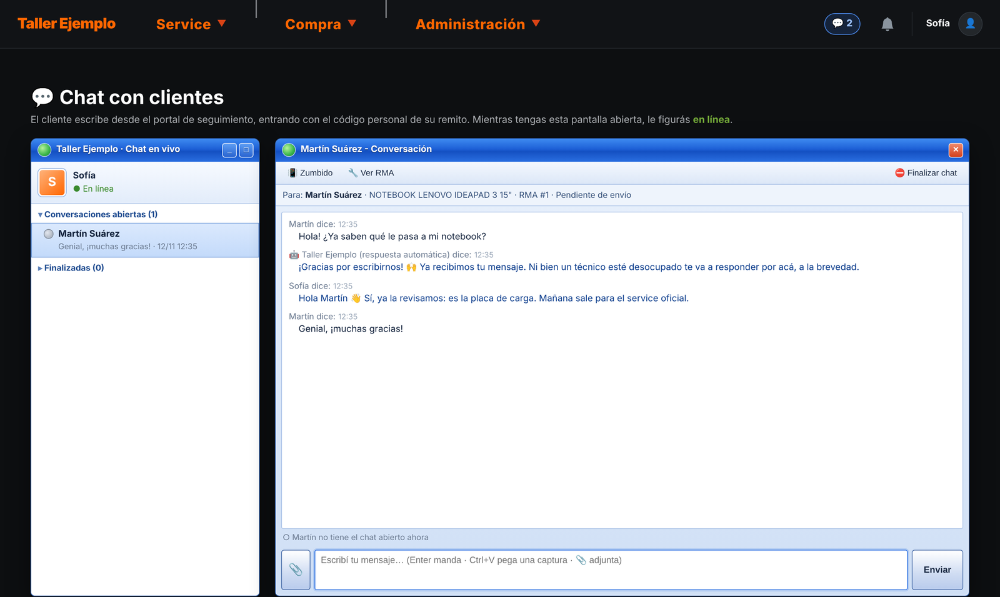
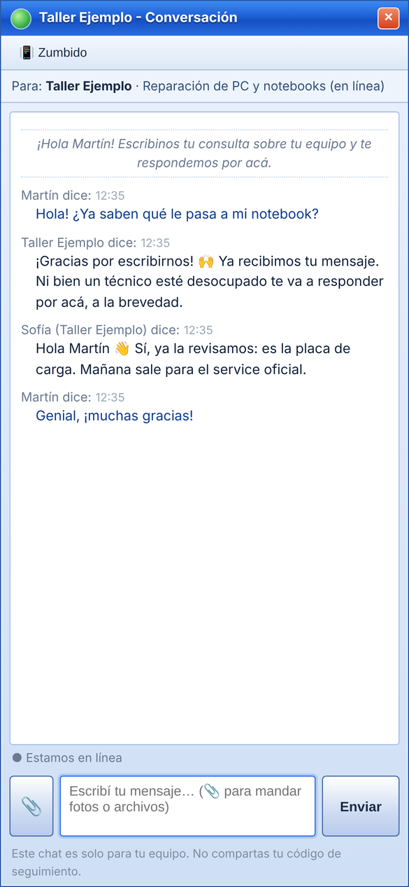
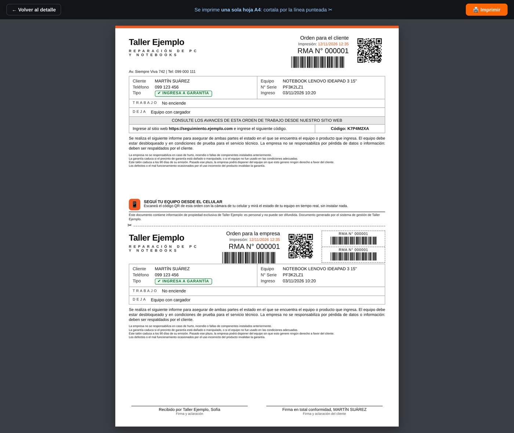
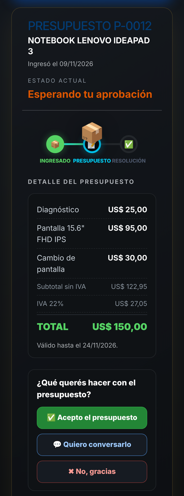

  

<h1 align="center">Sistema para Servicio Técnico</h1>

  Garantías (RMAs), presupuestos, seguimiento online con QR y chat en vivo con tus clientes. 
  <b>En la web o instalado en tu PC.</b> Pago único, sin mensualidades.

  
  &nbsp;
  
  &nbsp;
  

> [!TIP]
> **🚀 Lanzamiento: 40% de descuento para los primeros 20.** Queda en **US$ 47** en vez de US$ 79, con el código
> **`LANZAMIENTO`**. [Usar el descuento →](https://fotech.gumroad.com/l/servicio-tecnico/LANZAMIENTO)

  
  
  

---

## ¿Qué es?

Un sistema hecho **por y para un servicio técnico de verdad**, usado todos los días en un local de reparación de PC.
Ordena todo lo que entra al taller: el equipo del cliente, el presupuesto, la garantía con el proveedor, el aviso
cuando está listo y el retiro.

El cliente **sigue su equipo desde el celular** escaneando el QR del remito. Ahí mismo puede **aceptar el
presupuesto** o **chatear con el taller**, sin instalar nada y sin llamarte.

## Capturas

<table>
  <tr>
    <td width="66%"> <b>Panel de RMAs.</b> Cada equipo con su estado, proveedor y días en el taller.</td>
    <td width="34%" rowspan="2"> <b>Lo que ve tu cliente</b> al escanear el QR.</td>
  </tr>
  <tr>
    <td> <b>Presupuestos</b> con precios con IVA incluido. Se mandan por WhatsApp con un clic.</td>
  </tr>
  <tr>
    <td> <b>Chat en vivo</b> estilo Messenger, con fotos, archivos y respuesta automática.</td>
    <td> El mismo chat, <b>desde el celular del cliente</b>.</td>
  </tr>
  <tr>
    <td> <b>Remito de ingreso</b> en una hoja A4: copia para el cliente con QR y copia para el taller.</td>
    <td> El cliente <b>acepta, rechaza o pide conversar</b> el presupuesto.</td>
  </tr>
</table>

## Qué incluye

| | |
|---|---|
| 📋 **Garantías (RMAs)** | Ingreso del equipo, estados, fotos, notas, historial, proveedor y orden de cada uno. |
| 🧾 **Presupuestos** | Reparación o venta, con IVA incluido, archivos adjuntos para el cliente, impresión y remito. |
| 📱 **Portal de seguimiento** | El cliente ve el estado de su equipo con el código del remito o escaneando el QR. |
| ✅ **Respuesta al presupuesto** | Acepta, rechaza o pide conversar desde el portal. A vos te llega el aviso. |
| 💬 **Chat en vivo** | Con el cliente, con fotos, videos y archivos. Tiene "zumbido" y respuesta automática. |
| 📲 **Avisos por WhatsApp** | Cuando cambia el estado: manual (gratis), con tu propio servidor (gratis) o con la API de Meta. |
| 🏢 **Clientes y empresas** | Agenda por cédula o RUT: los datos se completan solos. |
| 💲 **Tarifario** | Tu lista de precios de trabajos (limpieza, formateo, etc.) para mostrarle al cliente. |
| 📦 **Compras, envíos, catálogo, estadísticas** | La administración del día a día. |
| 👥 **Usuarios y permisos** | Cada usuario ve solo lo que le das: ver, editar o todo. |
| 🎨 **Tu marca** | Tu logo, nombre, datos y condiciones en los remitos, los avisos y el portal. |
| 💾 **Copias de seguridad** | En la versión de escritorio, una por día, automáticas. |

## Dos versiones, la misma licencia

| | 🌐 **Web** | 🖥️ **Escritorio (Windows)** |
|---|---|---|
| Dónde corre | En internet (PythonAnywhere u otro servidor). La cuenta gratis alcanza. | En una PC del local. |
| Desde dónde se usa | Cualquier PC o celular, desde cualquier lado | Esa PC y las demás PCs del local |
| Instalación | Guía paso a paso, unos 20 minutos | Instalador con doble clic |
| Portal y chat con clientes | ✅ | Próximamente |
| Copias de seguridad | Descargando los archivos | ✅ Automáticas |

## Precio

### 💰 Licencia Completa: **US$ 79**, pago único

Sin mensualidades. Para comparar, los sistemas parecidos se cobran entre **US$ 60 y US$ 100 por mes**.

**Incluye:**
- licencia **para siempre** para tu empresa;
- las **dos versiones**, web y Windows;
- uso en **hasta 2 lugares** (2 PCs, o la web y una PC);
- **1 año** de actualizaciones;
- soporte por correo.

| Extras opcionales | |
|---|---|
| 🧑‍🔧 **Te lo instalo yo**: lo dejo andando en tu PythonAnywhere o en tu PC, por videollamada | **+ US$ 30** |
| 🔄 **Renovación de actualizaciones**: si no renovás, el sistema sigue andando igual | **US$ 19 por año** |

  

## Cómo funciona la compra

1. **Probalo gratis 15 días.** Bajá el instalador de Windows desde [Releases](../../releases/latest).
2. **Comprá** la licencia (US$ 79). Pagás con tarjeta o PayPal.
3. **Recibís** el sistema completo con las dos versiones y la guía de instalación.
4. **Pasanos el código de tu PC** o la dirección de tu sistema web. Lo ves en ⚙️ → 🔑 Licencia.
5. **Recibís tu clave de licencia.** La pegás y listo: tus datos de la prueba quedan.

## Preguntas frecuentes

<b>¿Es un pago único o una suscripción?</b>

Pago único de US$ 79. La licencia no vence. Las actualizaciones están incluidas durante 1 año. Después el sistema
sigue andando igual, y si querés las versiones nuevas, renovás por US$ 19 al año.

<b>¿Mis datos y los de mis clientes dónde quedan?</b>

En **tu** servidor o en **tu** PC. Nosotros no los vemos ni los recibimos. El portal de seguimiento nunca muestra
nombre, teléfono, cédula ni dirección del cliente, solo el estado del equipo.

<b>¿Sirve para mi país?</b>

Hoy está pensado para **Uruguay**: pesos y dólares, IVA, C.I. y RUT. El porcentaje de IVA y la zona horaria ya se
pueden cambiar. Las monedas, los impuestos y los documentos de cada país de América vienen en la próxima versión.

<b>¿Está en inglés o portugués?</b>

Por ahora en español. Inglés y portugués están en camino.

<b>¿Qué necesito para la versión web?</b>

Una cuenta en [PythonAnywhere](https://www.pythonanywhere.com). La gratis alcanza: con dos cuentas tenés el sistema
y el portal de seguimiento. La guía te lleva paso a paso, en unos 20 minutos.

<b>Windows dice "Windows protegió su PC". ¿Es seguro?</b>

Sí. Ese aviso aparece con los programas nuevos que no pagan un certificado de firma. Tocá **Más información →
Ejecutar de todas formas**.

<b>¿Puedo modificarlo?</b>

Sí, para tu propia empresa: pantallas, textos, lo que necesites. Lo que no se puede es revenderlo ni
redistribuirlo. Ver [LICENCIA.md](LICENCIA.md).

## Apoyá el proyecto

Si no necesitás el sistema pero te gusta la idea, o ya lo compraste y querés dar una mano extra:

  

Cada aporte va a nuevas funciones: más países, inglés y portugués, y el portal en la versión de escritorio.

## Contacto

📧 [forzen_rog@hotmail.com](mailto:forzen_rog@hotmail.com): ventas, licencias y soporte.

---

🇺🇸 <b>English summary</b>

**Repair shop management system**: warranty tickets (RMAs), quotes, a customer tracking portal with QR codes, and
live chat with your customers. Customers follow their device from their phone and can accept quotes online.
Available as a **web app** or a **Windows desktop app**.

**US$ 79, one-time payment, no monthly fees.** The lifetime license covers both versions, up to 2 installs, 1 year
of updates, and support. Optional extras: installation (+US$ 30) and update renewal (US$ 19/year). **15-day free trial.** The interface is currently in Spanish. English and Portuguese are
coming soon.

[Buy](https://fotech.gumroad.com/l/servicio-tecnico) · [Free trial](../../releases/latest) · [Donate](https://ko-fi.com/fotech)

© 2026 FoTech · Software con licencia: no es de código abierto. Este repositorio muestra el producto. El sistema se
entrega al comprarlo.
